<p align="center">
  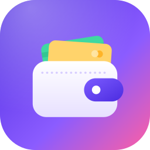
</p>

<h1 align="center">Kova</h1>
<p align="center"><b>Your money, beautifully simple.</b><br/>A free, open-source, private & offline personal finance app for Android — in <b>English</b> and <b>Português</b>.</p>

<p align="center">
  <a href="../../releases/latest/download/kova.apk"><b>⬇️ Download the latest APK</b></a>
</p>

<p align="center">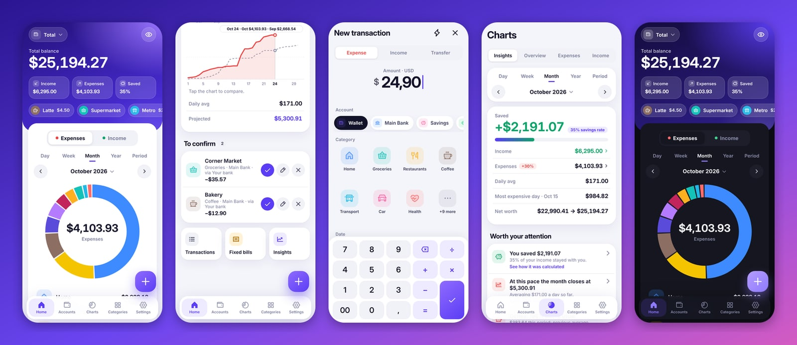</p>

## ✨ Features

- **Home** — account picker, balance (with a privacy switch), quick-launch shortcuts, expenses/income by category for any day, week, month, year or custom period.
- **Spending pace** — running total of this period against the previous one, compared fairly up to the same day ("+54% vs 1–24 Sep"), plus daily/monthly bars and a month-end projection.
- **Automatic entries from bank notifications** — Kova reads purchase, Pix and transfer notifications from the bank apps you choose (N26, Nubank, Revolut, Inter, Wise…): amount, currency and merchant. It shows its own notification with **Confirm / Edit / Not a transaction**, learns your categories per place, skips promotions and duplicates, pairs money moving between your own accounts as a transfer, and adds by itself once it is sure. Everything stays on the phone.
- **Home-screen widgets** — month-to-date spending with the same-day comparison, top categories, a running-total chart and *+ Expense* / shortcut buttons (4×2 and a 2×1 mini).
- **Insights** — monthly, quarterly and yearly reports: how much you saved, where the money went, biggest expenses, non-essential spending, fixed costs detected automatically, budget alerts, net-worth change — each with “see how it was calculated”.
- **Fast entry** — calculator keypad, shortcuts (⚡ to save any entry as one), note autocomplete, tags, today/yesterday/any date, attachments (photos or PDFs).
- **Planned, recurring & fixed bills** — future-dated entries, weekly/monthly/yearly repeats and reminders before each due date.
- **Accounts & currencies** — unlimited accounts in any currency, transfers (including cross-currency), drag to reorder, archive.
- **Categories** — 180+ icons (Phosphor), colors, monthly budgets, drag to reorder.
- **Privacy & safety** — PIN lock with fingerprint, hide balances, automatic backup after every change (one file per month, last 12 kept, on the phone and in *Documents/Kova*), restore offered on a fresh install, share a backup to Drive/e-mail in one tap.
- **Your data stays on your phone.** No account, no ads, no tracking. English & Português, light & dark.
- **Import** — bring your history from a `.mmbackup` file exported by another finance app; export/restore Kova backups (`.json`) and export CSV.

## 📸 Screenshots

| Home | Spending pace | To confirm (from bank notifications) |
|---|---|---|
| 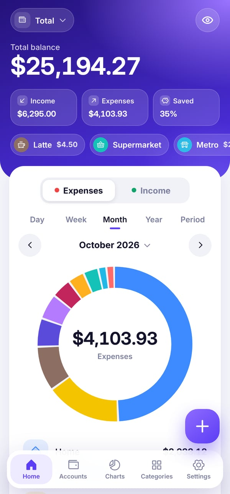 | 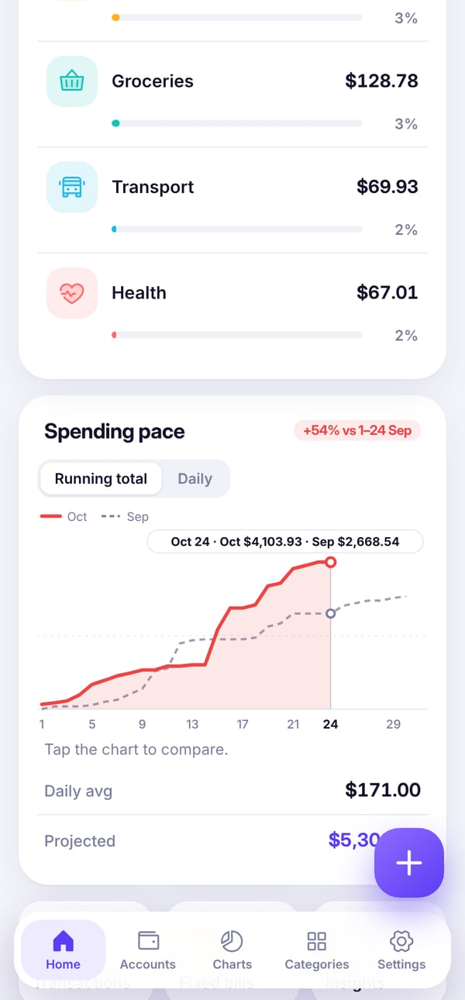 | 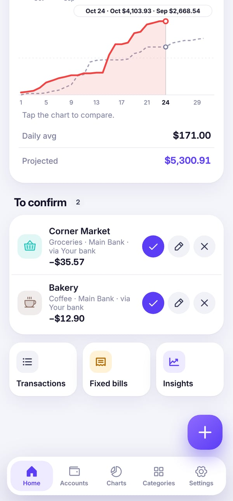 |
| **New transaction** | **Insights** | **Automatic entries** |
| 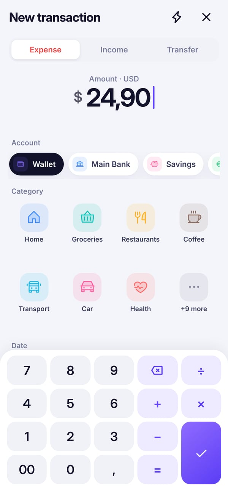 | 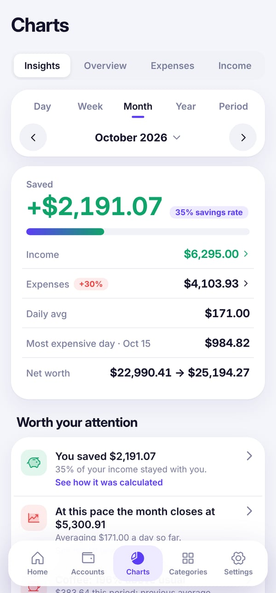 | 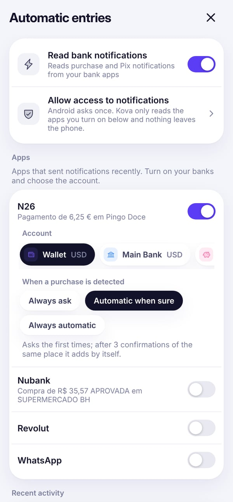 |
| **Accounts** | **Categories** | **Dark mode** |
| 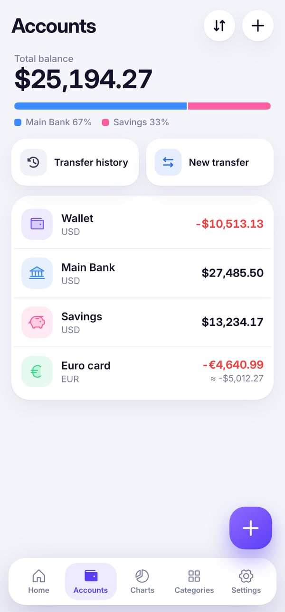 | 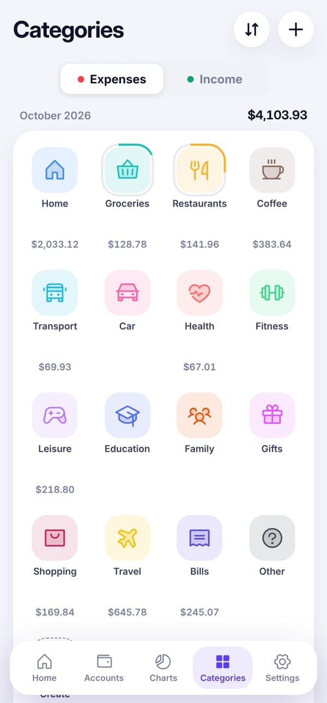 | 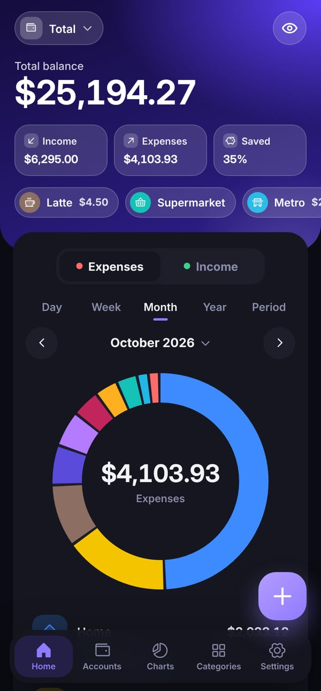 |

<sub>Screenshots use demo data.</sub>

## 📲 Install

1. Open **[Releases](../../releases/latest)** on your Android phone and download `kova.apk`.
2. Open the file and allow *Install unknown apps* for your browser/file manager when asked.
3. Done! To move your data from another app, go to **Settings → Import backup (.mmbackup)** (or tap it on the welcome screen).

> Updates install over the previous version (same signing key), keeping your data.

## 🛠️ Build it yourself

Requirements: Node 20+, JDK 21, Android SDK.

```bash
npm install
npm run build            # bundles the web app into dist/
npx cap add android      # first time only
cp -r android-res/* android/app/src/main/res/   # app icons
npx cap sync android
cd android && ./gradlew assembleDebug
```

Every push to `main` builds a signed APK on GitHub Actions and publishes it as a release (see `.github/workflows/android.yml`).

### Signing

For convenience the repository ships a **public** keystore (`keystore/kova-release.jks`, password `kova-open-source`) so CI builds are always installable as updates. If you fork Kova and distribute your own builds, add the secrets `KOVA_KEYSTORE_BASE64` and `KOVA_KEYSTORE_PASSWORD` (alias `kova`) to use your private key instead.

## 🧱 Tech

React 19 + TypeScript, bundled with esbuild, packaged with Capacitor 7. Charts are hand-made SVG; icons from [Phosphor](https://phosphoricons.com) via react-icons; fonts Inter and Inter Display (OFL). Native code lives in `android-src/` (Java): edge-to-edge system bars, home-screen widgets, the notification reader (`TxParser` — unit-testable pure Java) and fingerprint unlock. `.mmbackup` files are parsed by a tiny built-in SQLite reader.

```
src/
  lib/        data model, store (IndexedDB), calculations, importer, SQLite reader
  screens/    Home, Accounts, Charts, Categories, Settings, Transactions
  components/ UI kit, charts, editors
  i18n/       English & Portuguese
```

## License

MIT © Filipe Cruz
