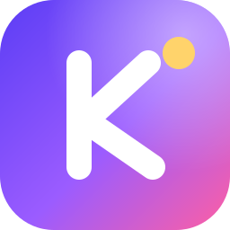
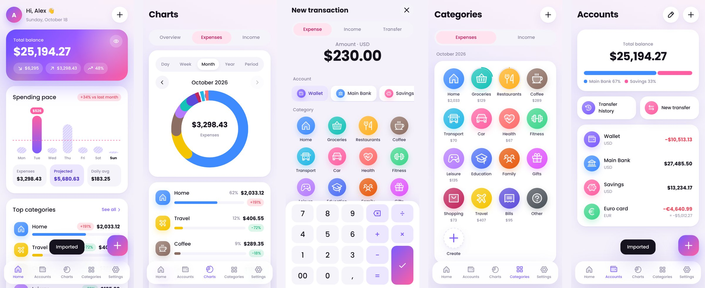
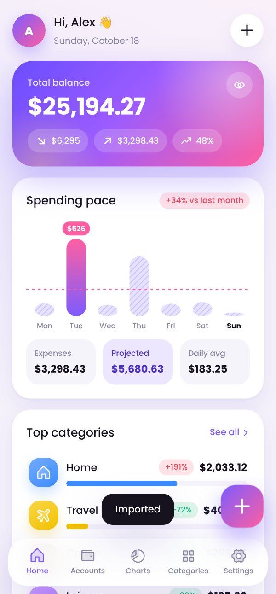
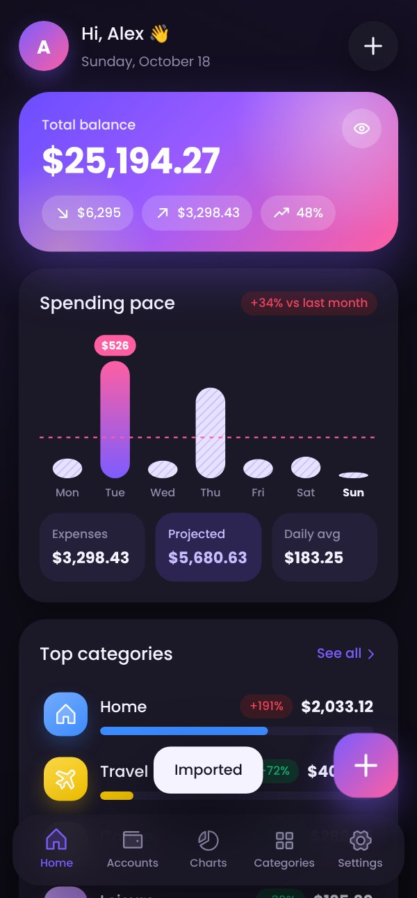

<p align="center">
  
</p>

<h1 align="center">Kova</h1>
<p align="center"><b>Your money, beautifully simple.</b><br/>A free, open-source, private & offline personal finance app for Android — in <b>English</b> and <b>Português</b>.</p>

<p align="center">
  <a href="../../releases/latest/download/kova.apk"><b>⬇️ Download the latest APK</b></a>
</p>

<p align="center"></p>

## ✨ Features

- **Home** — total balance, monthly income/expenses, savings rate, *spending pace* with month-end projection, top categories vs last month, achievements and recent activity.
- **Accounts** — unlimited accounts in any currency (BRL, EUR, USD…), balance distribution, transfers between accounts (including cross-currency), archive and reorder.
- **Charts** — income vs expenses vs savings by month/year, category donut, per-category trends, comparison with the previous period. Day / week / month / year / custom period.
- **Categories** — 180+ modern icons (Phosphor), 24 colors, optional monthly budgets with progress rings.
- **Settings** — language (auto / English / Português), light/dark/system theme, hide balances, main currency, exchange rates (manual or online update), backups.
- **Fast entry** — built-in calculator keypad, tags, notes, today/yesterday shortcuts.
- **Your data stays on your phone.** No account, no ads, no tracking.
- **Import** — bring your history from a `.mmbackup` file exported by another finance app. Export/restore Kova backups (`.json`) and export CSV.

| Home | Dark mode |
|---|---|
|  |  |

## 📲 Install

1. Open **[Releases](../../releases/latest)** on your Android phone and download `kova.apk`.
2. Open the file and allow *Install unknown apps* for your browser/file manager when asked.
3. Done! To move your data from another app, go to **Settings → Import backup (.mmbackup)** (or tap it on the welcome screen).

> Updates install over the previous version (same signing key), keeping your data.

## 🛠️ Build it yourself

Requirements: Node 20+, JDK 21, Android SDK.

```bash
npm install
npm run build            # bundles the web app into dist/
npx cap add android      # first time only
cp -r android-res/* android/app/src/main/res/   # app icons
npx cap sync android
cd android && ./gradlew assembleDebug
```

Every push to `main` builds a signed APK on GitHub Actions and publishes it as a release (see `.github/workflows/android.yml`).

### Signing

For convenience the repository ships a **public** keystore (`keystore/kova-release.jks`, password `kova-open-source`) so CI builds are always installable as updates. If you fork Kova and distribute your own builds, add the secrets `KOVA_KEYSTORE_BASE64` and `KOVA_KEYSTORE_PASSWORD` (alias `kova`) to use your private key instead.

## 🧱 Tech

React 19 + TypeScript, bundled with esbuild, packaged with Capacitor 7. Charts are hand-made SVG; icons from [Phosphor](https://phosphoricons.com) via react-icons; font Poppins (OFL). Backups are parsed by a tiny built-in SQLite reader — no native code.

```
src/
  lib/        data model, store (IndexedDB), calculations, importer, SQLite reader
  screens/    Home, Accounts, Charts, Categories, Settings, Transactions
  components/ UI kit, charts, editors
  i18n/       English & Portuguese
```

## License

MIT © Filipe Cruz
